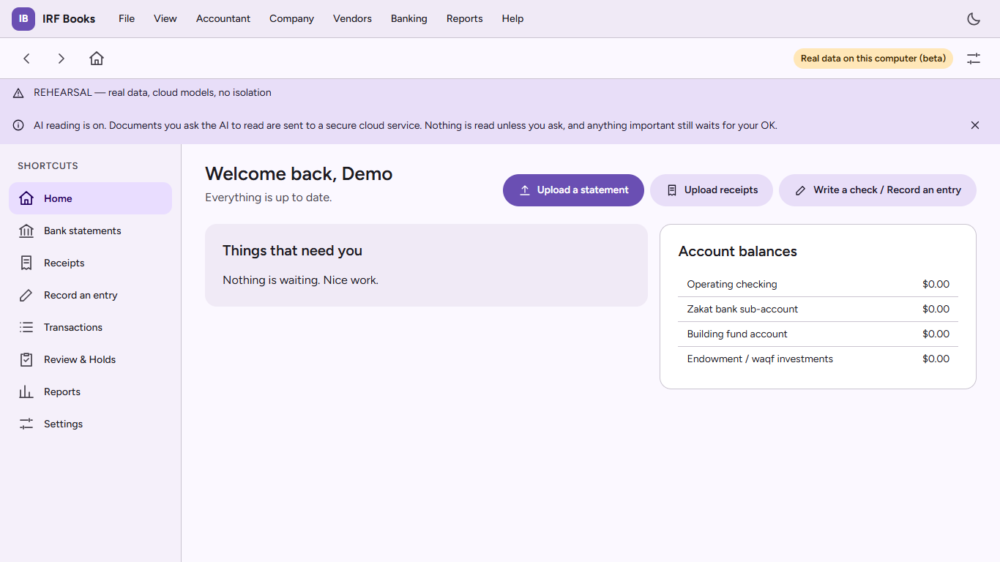
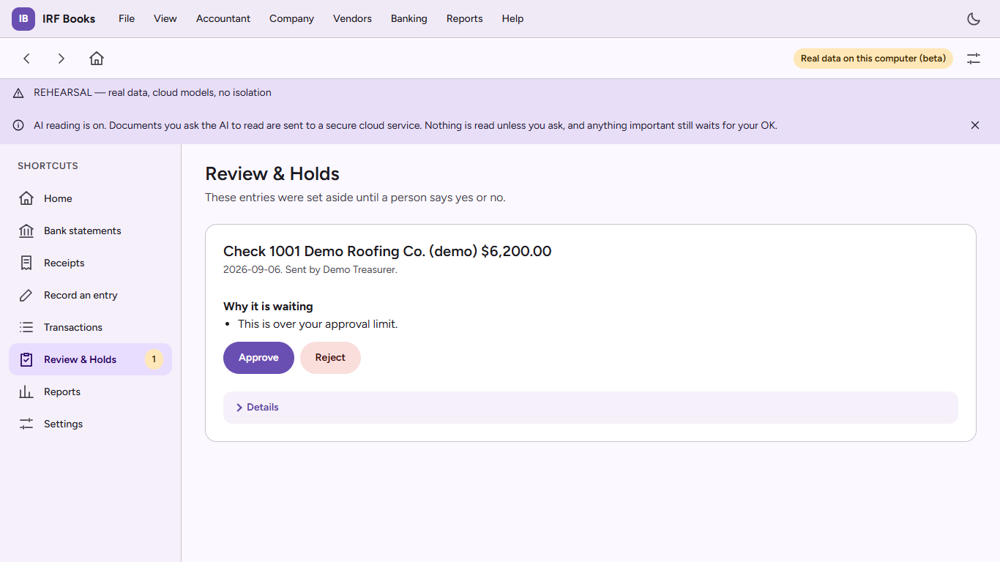
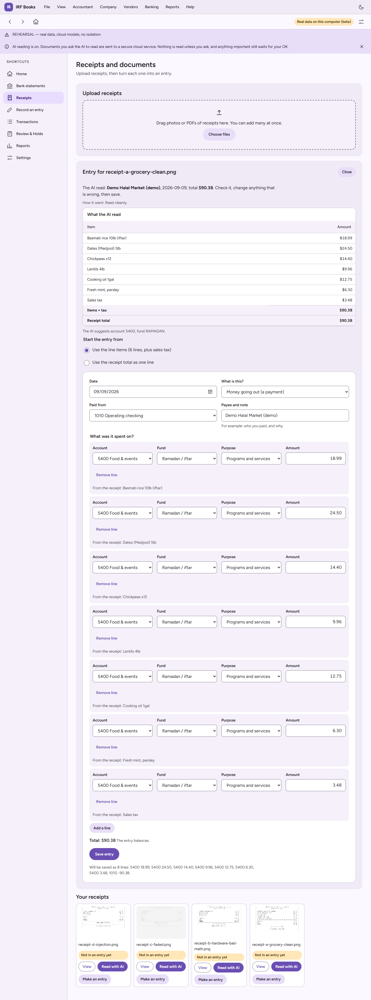
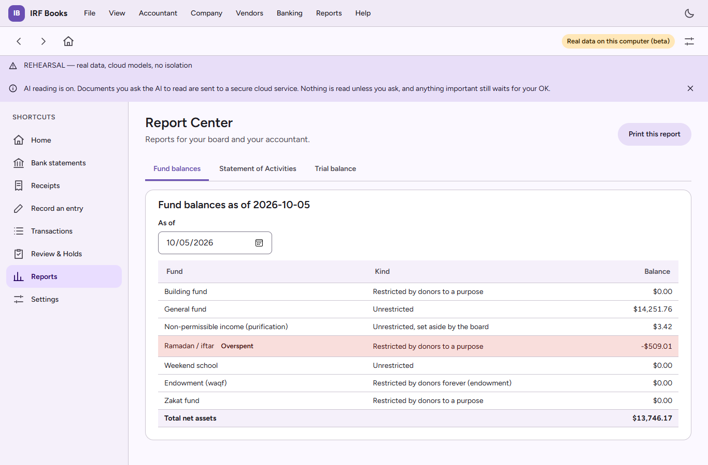

# Ledgerline

Ledgerline is an AI-first, multi-user accounting platform written in Rust and React. I started it as a replacement for QuickBooks Desktop for a nonprofit that needs fund accounting (restricted and unrestricted funds that each have to balance on their own). It is still in development and may become a product, so this repository holds only the overview and screenshots. The source code is not published.

All screenshots use demo data (a fictional organization, vendors and receipts). The product was previously called IRF Books internally, and that name still appears in the UI in the screenshots.

## What it does

- Keeps a ledger that can only be appended to. Mistakes are fixed with reversing entries, never edits or deletes.
- Tracks money by fund. Every fund balances on its own, and a report shows each fund's balance (and flags an overspent restricted fund).
- Puts hard stops where a person must decide: entries over an approval limit, restricted-fund spending and closed periods wait in a Review and Holds queue until someone approves or rejects them.
- Reads receipts with an AI model, only when the user asks. It shows what it read next to the receipt total and flags it when line items, tax and the total disagree. Nothing is posted until a person saves the entry.
- Imports bank statements, produces trial balance, statement of activities and fund balance reports, and runs from a Docker package with one-click start scripts.

## Architecture overview

```
React 19 + TypeScript web client (Vite, TanStack Query)
        |  HTTP/JSON
axum API (tokio) ---- auth, roles, approval limits, hard stops
        |
Rust workspace, 17 crates
  core, model        domain types; money is integer minor units (debits positive, credits negative)
  db, ledger         PostgreSQL via sqlx; append-only ledger tables, no UPDATE/DELETE path
  sealer             signs and seals the ledger so tampering is detectable
  intake, quarantine receipt and document intake; untrusted content is screened before any model sees it
  agents, workers    AI helpers and background jobs; the receipt reader has no tools and sits behind a prompt-injection screen
  statements, reports bank statement import and financial reports
  backup             backup and restore
  mcp, cli           an MCP server and a command-line tool over the same operations
  fixtures, bench    synthetic data generators and benchmarks
        |
PostgreSQL
```

Design choices:

- Controls live in the data layer, not only in the UI: the ledger has no way to update or delete a posted row.
- A document is treated as hostile input. The AI receipt reader gets text only, has no tools, and its output goes through a human before it becomes an entry.
- Person names are not sent to an AI model.
- Every feature goes through a gated process: a design note, tests written first from the spec, review, a mutation-testing gate, end-to-end tests and a merge-gate review.

## Stack

Rust (axum, tokio, sqlx), PostgreSQL, React 19, TypeScript, Vite, TanStack Query, Vitest, Playwright, Docker, GitHub Actions.

## Screenshots

Home:



Review and Holds, where an over-limit check waits for approval:



A receipt read by the AI, with the line items and total to check before saving:



Fund balances report:



## License

All rights reserved. See LICENSE.